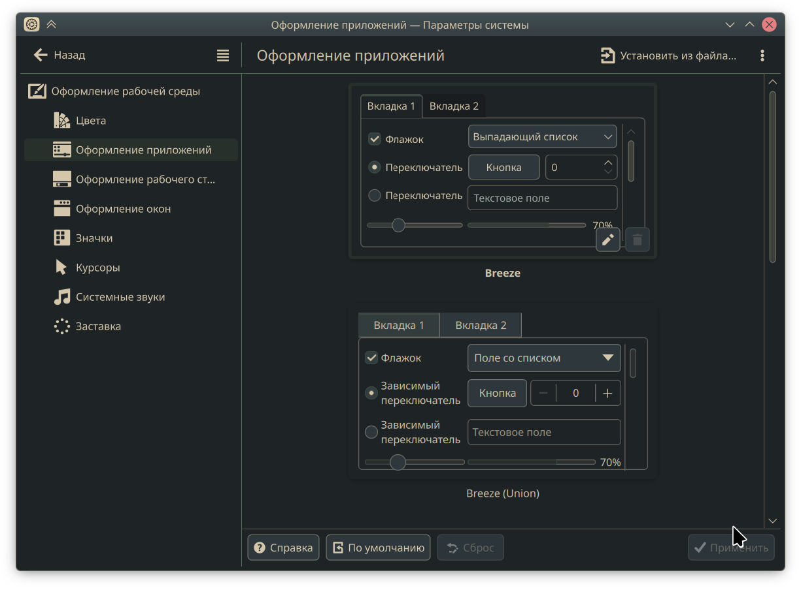
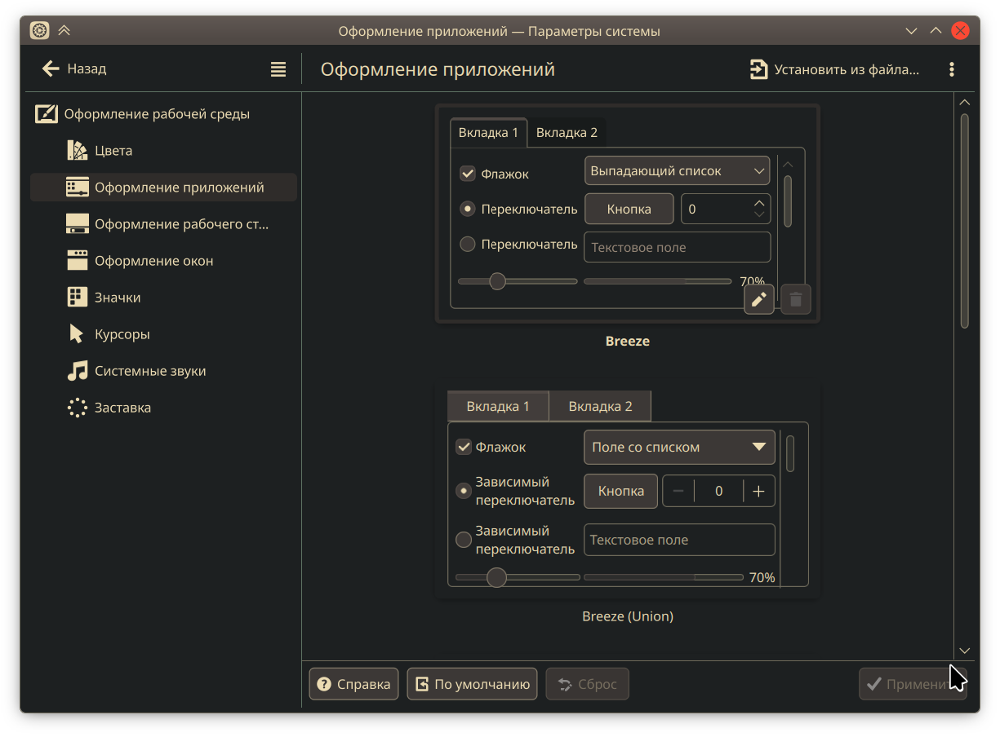
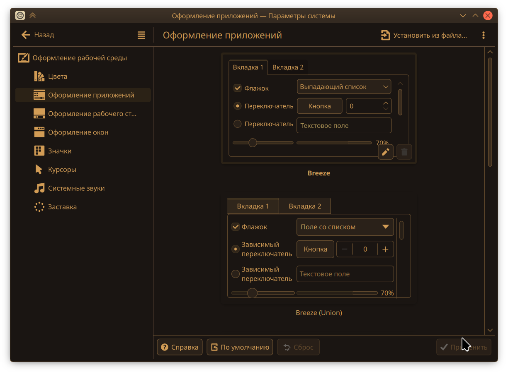

# Linux themes and color schemes

Color schemes for the KDE Plasma 6 desktop, I made it for myself, and I use it myself.
Designed and tested with the
**Klassy** window decoration and application style (they work fine with **Breeze**
too - the Klassy-specific behaviors simply fall back gracefully).
Also there are (or could be) some other color-scheme things for some apps.

---

**(Yet Another) Everforest Dark Hard**. A port of the [Everforest](https://github.com/sainnhe/everforest) palette (dark, *hard* background variant) by sainnhe (MIT). Every color value is canonical - no invented shades. 

**(Yet Another) Gruvbox Dark Hard**. A port of the [gruvbox](https://github.com/morhetz/gruvbox) palette (dark, *hard* background variant) by morhetz (MIT). Mine based on the GruvboxDarkHard scheme, with the menu-highlight readability fix applied. 

**P3-CRT Soft**. An original theme: a softened P3-phosphor amber CRT look. Foreground contrast was tuned to ~7.4:1 to avoid the eye strain of full-saturation amber terminals. Yes, it is not strictly amber theme: it is inspired by monochrome CRT, but it is not totally monochrome. Only the main colors are amber-ish.

<table>
  <tr>
    <td></td>
    <td></td>
    <td></td>
  </tr>
</table>

---

## Design notes

1. **Klassy compatibility.** These schemes deliberately contain **no
`[Colors:Header]`** groups. In Klassy (and Breeze), the presence of that group
activates "tools area" mode: the menubar is repainted as an extension of the
titlebar and the accent separator line under the titlebar is suppressed. Personally, 
I hate that. So, with these files you get the intended look:

    - a **separator line** under the window titlebar (*uhm, this is Klassy thing, not Breeze*), colored by
  `[Colors:Button] DecorationFocus`,
    - a **menubar that differs from the titlebar** (titlebar uses the lighter
  `bg2` step via `[WM] activeBackground`; menubar follows the window color).

2. **Readable menu highlights.** Strong focus (on by default) paints a
hovered menubar item with `[Colors:View] DecorationHover` and an opened menu
item with `DecorationFocus`. Both are dark, palette-tinted fills here — not
the vivid accent - so the highlighted text stays readable (>=4:1), and the
hover and open states are visually distinct.

3. **Selection color.** *(Yet Another) Everforest Hard* uses `bg_green` (green-tinted) for
selection, not the red-ish `bg_visual` used by some other ports.

## Installation

*I'll write it. Someday... Probably... We'll see...*

## Credits & license

* **Everforest** palette © sainnhe, MIT license — <https://github.com/sainnhe/everforest>.
  This repository is a port of that palette to KDE; it is not affiliated with
  or endorsed by the Everforest author. An earlier KDE port exists
  ([Serge2702/KDE-Everforest](https://github.com/Serge2702/KDE-Everforest));
  this one was written independently with a different focus.
* **gruvbox** palette © Pavel Pertsev (morhetz), MIT license -
  <https://github.com/morhetz/gruvbox>. The theme is derived from KDE's
  official `gruvbox Dark` theme (© 2017 Pavel Pertsev, 2020 Frederik Banning,
  MIT).
* **P3 CRT Soft** is an original theme by me (MagnusKos), MIT license.
